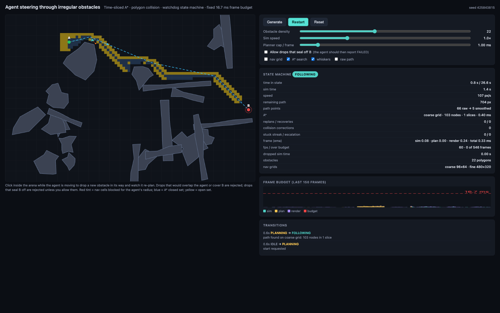
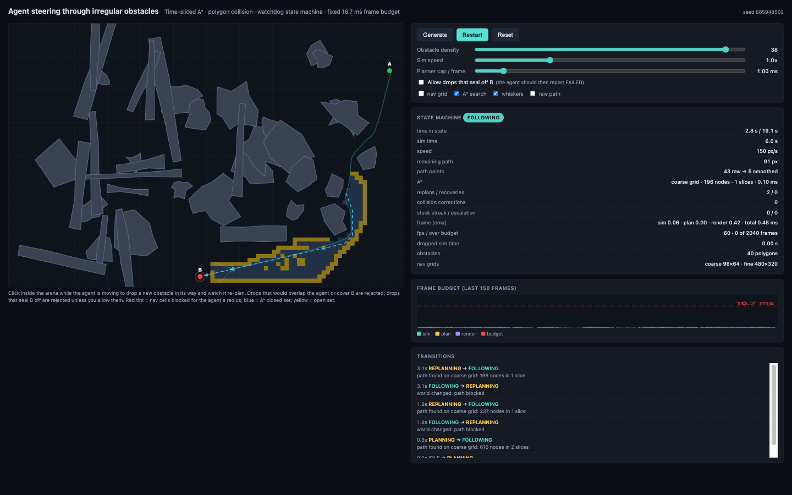

# MazeRoute: real-time path planning that never gets stuck

> A car-like agent drives from A to B through a field of irregular obstacles while you drop new ones
> in its way. It plans for its own footprint, re-plans around every drop, and always ends in
> `ARRIVED` or an honest `FAILED`. Every frame stays inside 16.7 ms, in the browser and on an
> ESP32-S3.

- **Web app**: vanilla JavaScript and canvas, no build step and no dependencies.
- **C++23 port**: the same simulation core, 10 to 20 times faster, matched against the JavaScript run for run.
- **ESP32-S3 port**: single-precision core running live on the chip, drawn in a web page over USB.

<p align="center"><em>▶ Demo (1:33): missions computed on the ESP32-S3, with obstacles dropped mid-run</em></p>

https://github.com/user-attachments/assets/13b5e11d-4e93-4f7c-8a45-1285ab4c6e87

## Try it

```sh
python3 -m http.server 8765     # then open http://localhost:8765/
```

Press **Generate**, then **Start**. While the agent moves, click the arena to drop an obstacle in
its way. Turn on **Allow drops that seal off B** to see it end in `FAILED` with a reason instead.

<table>
  <tr>
    <td align="center"><br><em>Planning and following</em></td>
    <td align="center"><br><em>Drops mid-run, re-plan</em></td>
  </tr>
</table>

## What it solves

| Problem | Approach |
| --- | --- |
| **Steering a directional agent** | Turn-rate and acceleration limits. Pure pursuit with a look-ahead point that is pulled back until the agent's whole body can see it, so it never aims through a corner. Corner speed limits, and pivoting in place when the heading error is large. |
| **Colliding with irregular shapes** | Exact circle-vs-polygon tests on concave polygons, with a spatial hash for broadphase. Planning runs on grids inflated by the agent's radius, so A* plans for its footprint. Three tiers: a 10 px coarse grid, a 2 px fine grid, and a 1 px escape when the agent is pushed somewhere no grid cell can represent. |
| **Never getting stuck** | A state machine (`IDLE → PLANNING → FOLLOWING ⇄ RECOVERING → REPLANNING → ARRIVED / FAILED`). Every state has a deadline, a progress watchdog catches stalls, and recovery escalates in bounded steps. Every transition is logged with its reason. |
| **A fixed frame budget** | Fixed-timestep simulation with a sub-step cap. A* and the fine-grid build are resumable and run in time slices sized by what is left of the frame after rendering. |

The full write-up, including the bugs the stress suite found and how each was fixed, is in
[`docs/DESIGN.md`](docs/DESIGN.md).

## Verified

Every number below comes from one recorded run, with raw output in
[`results/runs/20261031T035331Z`](results/runs/20261031T035331Z/SUMMARY.md).

| Environment | Missions | Failures |
| --- | --- | --- |
| JavaScript (the browser code, run in Node) | 12,000 | 0 |
| C++23, double | 36,000 | 0 |
| C++23, float core at four slice budgets | 144,000 | 0 |
| ESP32-S3, on the chip | 300 | 0 |
| **Total** | **192,300** | **0** |

On the chip, **0 of 10,065 real-time frames** went over 16.7 ms while obstacles were being dropped;
the worst frame took 14.8 ms. A failure is anything other than reaching B. In the scenarios where
drops may seal B off, `FAILED` counts as a pass only if an independent 1 px flood-fill oracle
confirms that no route exists.

```sh
node tests/run.js 300 1                                        # JS stress suite, exit code 1 on any failure
cmake -S cpp -B cpp/build && cmake --build cpp/build
./cpp/build/suite 300 1 && ./cpp/build/bench                   # C++ suite and benchmark
```

| Operation (Apple M4, median) | JavaScript | C++ |
| --- | --- | --- |
| Generate a world | 4.0 ms | 0.32 ms |
| Build the fine grid | 80 ms | 3.7 ms |
| Validate and apply a drop | 5.5 ms | 0.35 ms |
| Fine-grid A*, unsliced | 21 ms | 2.2 ms |

## Layout

```
index.html, css/, js/    browser app: geometry, world, pathfinder, steering, scheduler, main
tests/                   headless stress suite, benchmarks, single-seed replay
cpp/                     C++23 port with the same suite and benchmark
esp32/                   ESP32-S3 firmware, float core, host build, USB bridge, live web view
results/                 scripted runs of every suite and benchmark, with raw output
docs/DESIGN.md           how each problem is solved, and what the stress suite found
media/                   demo video and screenshots
```
